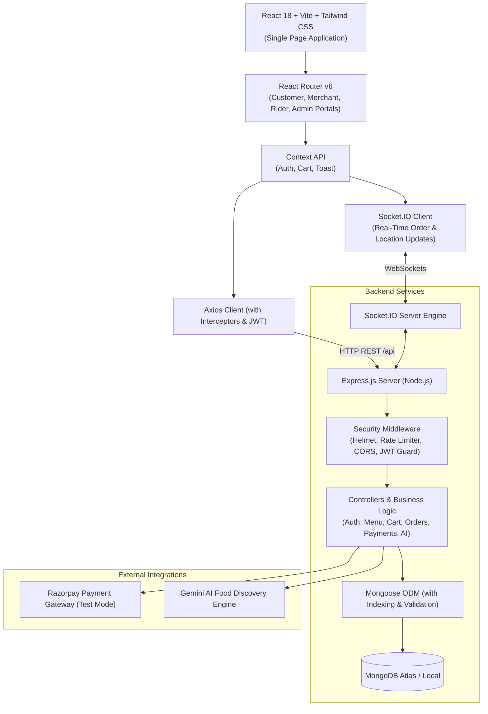

# Prime Platter - Full-Stack Food Delivery Platform

[](https://react.dev/)
[](https://tailwindcss.com/)
[](https://nodejs.org/)
[](https://socket.io/)
[](https://www.mongodb.com/)
[-emerald.svg)](https://jestjs.io/)

A modern, scalable, commercial-grade food delivery web application inspired by the functionality and user experience of **Swiggy** and **Zomato**.

---

## 1. System Architecture



---

## 2. Key Features Across 4 Role Portals

### 👤 Customer Experience
- **Swiggy/Zomato Inspired UI:** Orange-and-white theme, hero promos, category carousel, and typography.
- **Menu Search & Filtering:** Filter by dietary preference (Veg / Non-Veg), cuisine, price range, and sort by ratings or delivery time.
- **Customizable Dishes:** Add-ons (extra cheese, sauces, drinks), portion size selection, and special instructions.
- **Slide-over Cart:** Real-time bill breakdown, coupon codes (`WELCOME50`, `TASTY20`, `FREEDEL`), and free delivery threshold indicator.
- **Checkout & Payments:** Saved delivery addresses, Cash on Delivery (COD), and Razorpay test payments.
- **Real-Time Live Order Tracking:** Step-by-step milestone stepper and animated GPS route tracking powered by Socket.IO.
- **Order History & Reorder:** Quick one-click reordering and rating/review feedback.

### 🍳 Restaurant Owner Dashboard (`/restaurant-dashboard`)
- Manage restaurant operating hours, delivery estimates, and live Open/Closed toggle.
- Add, edit, or delete menu items with dish photos, price, cuisine, and category.
- Instant stock availability toggle (In Stock / Out of Stock).
- Live incoming kitchen orders queue: Accept, Reject, Start Preparing, and Ready for Delivery.
- Restaurant gross revenue metrics and order analytics.

### 🛵 Delivery Partner Dashboard (`/delivery-dashboard`)
- Online / Offline duty status toggle.
- Assigned deliveries stream with customer address and phone contact.
- Milestone execution: Mark Picked Up → Mark Out for Delivery → Mark Delivered.
- Device GPS location synchronization using HTML5 Geolocation.
- Payout and earnings tracker.

### 👑 Admin Command Center (`/admin`)
- Platform-wide KPI counters: Total Revenue, Total Orders, Active Restaurants, Registered Users.
- Interactive **Recharts** visualizations: Monthly Revenue Trend and Order Volume Charts.
- Order moderation: Search orders, view customer information, and manual status override.
- Restaurant & menu catalog availability controls.
- Promo discount coupon creation and management.

---

## 3. Technology Stack

| Layer | Technologies |
|---|---|
| **Frontend** | React 18, Vite 5, Tailwind CSS 3, React Router v6, Axios, Lucide React, Framer Motion, Recharts 2.15, Socket.IO Client |
| **Backend** | Node.js (v18+), Express.js 4, Socket.IO 4, Mongoose 8, bcryptjs, jsonwebtoken, Helmet 8, express-rate-limit 7 |
| **Database** | MongoDB 7 / MongoDB Atlas (Indexed collections) |
| **Testing** | Jest 30, Supertest 7 (29 comprehensive automated integration tests) |

---

## 4. Getting Started & Local Setup

### Prerequisites
- Node.js (v18 or higher)
- MongoDB running locally on `mongodb://127.0.0.1:27017` or a MongoDB Atlas URI.

### Step 1: Install Dependencies
```bash
# Install root & backend dependencies
npm install

# Install frontend dependencies
cd frontend && npm install && cd ..
```

### Step 2: Environment Configuration
Copy `.env.example` to `backend/.env`:
```bash
cp backend/.env.example backend/.env
```
Ensure `MONGO_URI` and `JWT_SECRET` are configured:
```env
PORT=5001
NODE_ENV=development
CLIENT_URL=http://localhost:3000
MONGO_URI=mongodb://127.0.0.1:27017/food_delivery_db
JWT_SECRET=your_jwt_secret_key_here
RAZORPAY_KEY_ID=rzp_test_sampleKey123
RAZORPAY_KEY_SECRET=sampleKeySecret456
```

### Step 3: Seed Database with Initial Dishes and Demo Accounts
```bash
npm run seed
```

### Step 4: Run Application
To run the full stack:
```bash
# Terminal 1: Backend Server + Socket.IO (Port 5001)
npm run dev

# Terminal 2: Modern React Frontend (Port 3000)
npm run dev:frontend
```
Open **[http://localhost:3000](http://localhost:3000)** in your browser!

---

## 5. Demo Accounts

| Role | Email | Password | Dashboard Route |
|---|---|---|---|
| **Admin** | `admin@primeplatter.com` | `Admin@123` | `/admin` |
| **Restaurant Owner** | `spicyvilla@primeplatter.com` | `Restaurant@123` | `/restaurant-dashboard` |
| **Delivery Partner** | `rider@primeplatter.com` | `Rider@123` | `/delivery-dashboard` |
| **Customer** | `customer@primeplatter.com` | `Customer@123` | `/` |

---

## 6. Running Tests

The project features a complete automated integration test suite validating authentication, RBAC, cart manipulation, checkout, order state machines, payment signatures, webhooks, and AI queries:

```bash
npm test
```

Test Results: **29 passed, 29 total (100% pass rate in ~1.4 seconds)**.

---

## 7. Deployment Instructions

### Frontend Deployment (Vercel)
1. Build the production React assets:
   ```bash
   npm run build:frontend
   ```
2. The bundled assets will be generated in `frontend/dist`.
3. Set the Root Directory to `frontend` or point output directory to `frontend/dist`.
4. Configure environment variable `VITE_API_URL` to point to your deployed backend.

### Backend Deployment (Render / Railway)
1. Set the Start Command to:
   ```bash
   node backend/server.js
   ```
2. Configure environment variables in the Render dashboard:
   - `NODE_ENV=production`
   - `MONGO_URI=<Your MongoDB Atlas Connection String>`
   - `JWT_SECRET=<Random 32-character Secret>`
   - `CLIENT_URL=<Your Vercel Frontend Domain>`
   - `RAZORPAY_KEY_ID=<Your Razorpay Test Key>`
   - `RAZORPAY_KEY_SECRET=<Your Razorpay Secret>`
3. Ensure health check path is set to `/api/health`.
